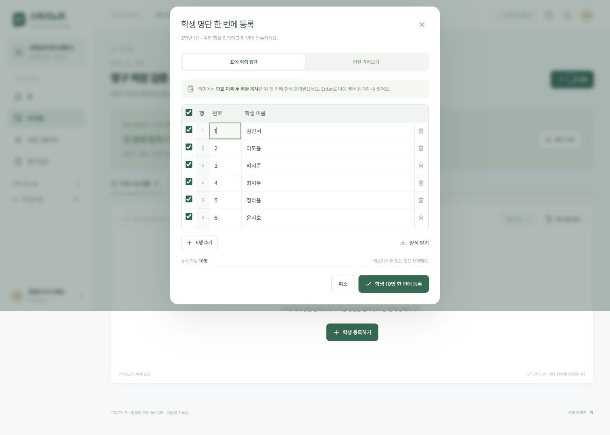

# 스피크노트 · Speaking Performance Assessment

React + TypeScript와 Spring Boot 3.5 / Java 17로 만든 교사용 말하기 수행평가 웹앱입니다. 회원가입 후 수업·학생을 등록하고 음성·영상을 기록하며, 평가 기준에 따라 교사가 점수·피드백을 작성하고 확정합니다.

## 현재 구현한 기능

- **실제 회원가입·로그인·로그아웃**: BCrypt 비밀번호 해시, HttpOnly / SameSite 세션 쿠키, CSRF 검사, 로그인 요청 제한. 인증 토큰을 localStorage에 보관하지 않습니다.
- **계정별 서버 저장**: 수업·학생·기준·평가를 DB에 보관합니다. 로그인 계정은 서버 세션으로 판단하며 요청의 교사 ID를 신뢰하지 않습니다.
- **학생 일괄 등록**: 엑셀처럼 표에 여러 명 입력, Enter로 다음 행, 번호·이름 두 열 붙여넣기, 행 추가·삭제, 선택 등록, 중복 번호 검사. 빈 이름은 제외합니다. 한 번에 저장하며 실패 시 일부만 등록하지 않습니다.
- **명단 파일**: `.xlsx` / CSV(UTF-8·CP949) / 텍스트 PDF를 편집 가능한 표로 가져옵니다. 첫 행에 번호·이름 열이 필요합니다. 스캔 PDF OCR은 지원하지 않습니다. 원본 명단 파일은 보관하지 않습니다.
- **평가 기준**: 직접 입력 및 PDF 텍스트 가져오기. 항목·배점 작성, 녹음 당시 기준의 스냅샷 보관.
- **녹음**: 학생 선택 → 음성 또는 영상+음성 → 일시정지·재개 → 미리보기 → 서버 저장. 업로드·DB 저장이 끝난 뒤 완료로 표시합니다. 오류 시 원본과 입력을 유지하며 재시도·다운로드할 수 있습니다.
- **원본 파일 보관**: 서버 비공개 디렉터리 + DB의 소유자·크기·SHA-256 메타데이터. 인증한 담당 계정만 재생·다운로드할 수 있습니다. 재시도는 같은 파일을 중복 저장하지 않습니다.
- **평가 관리**: 원본 재생, 수동 점수·피드백, 교사 확인 후 최종 확정, 검색·필터·CSV 내보내기.
- **홈·마이페이지**, 데스크톱·태블릿·휴대폰 반응형 UI. 사이드바 자체 스크롤과 화면 이동 후 본문 위치 초기화.
- **동시 수정 보호**: 자료의 revision으로 여러 탭의 변경을 감지하여 오래된 화면이 새 자료를 덮어쓰지 못하게 합니다. 충돌 시 입력을 보관하고 새로고침해야 합니다.

**AI 자동 전사·채점·영상 분석은 아직 연결되지 않았습니다.** 실제 녹음에 가짜 점수·근거를 생성하지 않습니다. 현재 영상은 촬영·업로드·재생까지 구현되어 있습니다. 이 저장 기반이 완성됐다는 것이 즉시 상용 출시 가능하다는 뜻은 아닙니다.

새 계정은 빈 공간으로 시작하며 예시 수업·학생·점수를 자동 생성하지 않습니다. 이전 체험 버전의 localStorage / IndexedDB 자료는 삭제하거나 서버에 자동 전송하지 않습니다. 이전 자료의 계정별 이전은 별도 작업입니다. 예전 화면 코드는 `frontend/src/LegacyApp.tsx`, Node AI 참고 코드는 `legacy/node-server/`에 남아 있습니다.

## 로컬 실행

필수: Node.js 24, Java 17~25. Maven Wrapper가 Maven을 설치합니다.

```sh
cp .env.example .env.local
npm ci
npm run dev
```

- 앱: http://127.0.0.1:5173
- 서버 상태: http://127.0.0.1:8080/api/health
- Swagger: http://127.0.0.1:8080/swagger-ui.html
- OpenAPI: http://127.0.0.1:8080/v3/api-docs

앱에서 회원가입 후 수업을 만드세요. 학생 등록에서 표에 입력하거나 엑셀 두 열을 복사해 첫 번호 셀에 붙여넣고 **학생 N명 한 번에 등록**을 누르면 됩니다. 실제 비밀번호·학생 자료를 Git에 올리지 마세요.

기본 `local` 프로필은 **파일 H2 DB**를 사용합니다. 루트 실행 시 `backend/data/speaking.mv.db`와 `backend/data/media/`에 저장하므로 서버를 재시작해도 자료가 유지됩니다. 세션은 재시작 시 만료되어 다시 로그인해야 합니다. 프로젝트 폴더·`data/`를 삭제하면 자료가 사라지므로 운영 백업을 대신하지 않습니다. 테스트는 별도 메모리 DB를 사용합니다.

마이크·카메라는 localhost 또는 HTTPS에서 브라우저 권한을 허용해야 합니다. 다른 기기에서 사용하려면 HTTPS 도메인을 준비해야 합니다. 기본 서버는 이 컴퓨터의 localhost에만 연결합니다.

## 환경변수와 PostgreSQL

루트 실행 도우미는 `.env.local` → `.env` 순서로 읽고 이미 설정한 환경변수를 우선합니다. 실제 값은 커밋하지 않습니다. Java 서버를 직접 실행할 때는 환경변수를 직접 설정하세요.

| 변수 | 설명 |
|---|---|
| `FRONTEND_PORT`, `BACKEND_PORT` | 기본 5173, 8080 |
| `BACKEND_URL` | Vite 프록시 대상, 기본 http://127.0.0.1:8080 |
| `SPRING_PROFILES_ACTIVE` | `local`, `postgres`, `production` |
| `LOCAL_DB_URL`, `LOCAL_DB_PASSWORD` | 로컬 H2 파일 DB 전용 설정 |
| `DB_URL`, `DB_USER`, `DB_PASSWORD` | PostgreSQL 설정. local 프로필에는 적용하지 않음 |
| `MEDIA_DIRECTORY` | 비공개 원본 디렉터리, 기본 `./data/media` |
| `SESSION_COOKIE_SECURE` | 로컬 HTTP는 false. production 프로필은 true 강제 |
| `SERVER_ADDRESS` | local 기본 127.0.0.1, production 기본 0.0.0.0 |

로컬 PostgreSQL을 사용하려면 Docker 실행 후 `docker compose --env-file .env.local up -d postgres`, `SPRING_PROFILES_ACTIVE=postgres`로 변경하고 재실행합니다. H2 자료는 PostgreSQL로 자동 이전되지 않습니다.

`production` 프로필은 DB 접속 정보와 영구 `MEDIA_DIRECTORY`를 필수로 요구하고 Secure 쿠키를 사용하며 Swagger를 비활성화합니다. 프런트 빌드와 `/api`를 **동일 HTTPS 도메인**으로 제공해야 합니다. Vite 개발 서버나 GitHub Pages로 서버 앱을 운영하지 않습니다. DB와 원본 디렉터리는 함께 백업·복구해야 합니다.

## API와 데이터

[API 계약](docs/API.md)을 참고하세요. `studio_teachers`, `studio_workspaces`, `studio_media`, `studio_audit`를 Flyway V2에서 생성합니다. 현재 수업·학생·평가는 계정별 검증된 JSON 문서로 저장하며 개별 엔티티 테이블로 정규화한 상태는 아닙니다. 문서 전체에 revision을 적용하므로 같은 계정의 다른 탭 수정은 충돌로 처리됩니다.

초기 제한: 계정당 수업 200개, 수업당 학생 1,000명(번호 1~999), 평가 항목 1~8개, 원본 파일당 200MB / 계정당 1GB. 실패한 평가 저장으로 남은 미연결 원본의 자동 정리는 아직 없습니다. PDF 추출은 12MB·30페이지까지입니다.

## 검증과 명령

| 명령 | 동작 |
|---|---|
| `npm run dev` | React·Spring Boot 동시 실행 |
| `npm run build` | 타입 검사 및 프런트 빌드 |
| `npm test` | 프런트 테스트 |
| `npm run test:backend` | 서버 통합 테스트 |
| `npm run build:backend` | 실행 JAR 생성 |
| `npm run check` | 타입·테스트·프런트 빌드·서버 테스트 |

프런트 테스트는 TSV 붙여넣기·행 확장·중복/기존 번호·한도와 CSV 해석을 확인합니다. 서버 테스트는 실제 세션·CSRF, 두 계정의 자료/원본 접근 분리, 30명 원자적 등록, 중복 거절, revision 충돌, 동일 원본 재시도와 다른 원본 충돌, byte-range 재생, PDF와 미구현 AI의 501 응답을 확인합니다. 실제 학생 채점 품질이나 실제 기기 녹음 품질을 보증하는 테스트는 아닙니다.

## 출시까지 남은 작업

1. 실제 음성 기반 STT·루브릭별 채점·타임스탬프 근거의 서버 작업 큐와 실패 재시도, 실제 학생 음성 검증. 영상 분석 항목과 공정한 평가 범위 정의.
2. 개인정보 처리·동의 기록, 보관 기간과 자동 삭제(원본·텍스트·백업 포함), 수동 삭제·계정 탈퇴. 현재는 자동 삭제나 저장매체 암호화를 구현했다고 표시하지 않습니다.
3. 이메일 소유 확인·비밀번호 재설정, 배포 환경의 요청 제한·권한 점검·감사 기록 보강.
4. PostgreSQL·객체 저장소·HTTPS 운영 배포, 비밀값 관리, 암호화·백업 복구·모니터링·장애 대응.
5. 실제 학교 파일럿, 교사 확인 흐름과 평가 일관성 검증 후 결제 연결.

## 일괄 등록 화면


